.. ------------------------------------------------------------------------------
.. Project: Hemerion Copyright (c) 2026, Onur Tuncer, PhD, Istanbul Technical University
..
.. SPDX-License-Identifier: GPL-3.0-only
.. License-Filename: LICENSE
.. ------------------------------------------------------------------------------

.. _f16_trim_ecos_cosim:

F-16 Trim Flyouts → Four Sensor FMUs → Flight Software Co-Simulation (``examples/f16_trim_ecos``)
=================================================================================================

``examples/f16_trim_ecos`` flies NASA TM-2015-218675's two open-loop **trim
flyouts** — atmospheric check-cases 11 and 12, selected with ``--case`` —
through the full sensor complement: Aetherion's ``F16Plant.fmu`` supplies
truth, **four** Hemerion hardware-simulator FMUs turn it into bus traffic, and
one flight-computer process consumes all four buses with the unmodified
``modules/sensors`` stacks the STM32H743 firmware cross-compiles.

Four of the five pieces are documented in detail on the rocket page
(:ref:`rocket_gps_ecos_cosim`): the GPS FMU (wire-exact UBX-NAV-PVT over UDP,
gated by the receiver's :ref:`dynamics envelope <gps_dynamics_envelope>`), the
IMU FMU (register counts into a FIFO behind a shared-memory
:ref:`SPI bus <imu_spi_interface>`), the BMP390 FMU (a register-accurate I2C
barometer that inverts the real Bosch compensation polynomial) and the
MMC5983MA FMU (an 18-bit I2C magnetometer whose bridge offset blocks bring-up
until a SET/RESET calibration runs, :ref:`rocket_gps_ecos_mag`). This page
covers what is new here:

1. **The plant is an aircraft in trim, not a rocket under thrust.**
   ``F16Plant.fmu`` runs its own trim solver during initialisation and seeds
   the control deflections from the result, so nothing closes a loop — the
   aircraft simply flies out of trim conditions for 200 s, and the slow
   phugoid drift that follows is the check-case's content, not an error.
2. **Two check-cases over one wiring** — one where every environment-dependent
   stack is in band for the whole flight, and one where two of the three are
   out of their envelopes at once, exercised through exactly the same code
   paths.

.. code-block:: text

   ┌──────────────────────┐   FMI 2.0 variables    ┌──────────────────────┐   UBX-NAV-PVT     ┌─────────────────────────┐
   │    F16Plant.fmu      │  (Ecos connections)    │ hemerion_gps_fmu.fmu │   over UDP        │   f16_flight_computer   │
   │  (Aetherion 6-DoF    ├───────────────────────>│ (u-blox M9N sim)     ├──────────────────>│  GpsDriver + UbxParser  │
   │   plant, Radau IIA   │  lat, lon, alt,        └──────────────────────┘  127.0.0.1:5762   │                         │
   │   on SE(3), with its │  NED velocity          ┌──────────────────────┐  SPI transfers    │  ImuSpiDriver + …       │
   │   own trim solver)   │  p/q/r, specific force │ hemerion_imu_fmu.fmu │<──────────────────┤                         │
   │                      ├───────────────────────>│ (MEMS IMU sim)       ├─── shared mem ───>│  Bmp390Driver + …       │
   │                      │  altitude              ┌──────────────────────┐  I2C transactions │                         │
   │                      ├───────────────────────>│ hemerion_bmp390_fmu  │<─── shared mem ──>│  Mmc5983maDriver + …    │
   │                      │  position + attitude   ┌──────────────────────┐  I2C transactions │                         │
   │                      ├───────────────────────>│ hemerion_mmc5983ma   │<─── shared mem ──>│  — the same modules/    │
   │                      │  (host-computed)       └──────────────────────┘                   │  sensors code the STM32 │
   └──────────────────────┘                                                                   │  H743 firmware runs     │
           │                                                                                  │                         │
           └────────────── f16_trim_cosim (Ecos master, fixed-step 10 Hz) ────────────────────┴─────────────────────────┘

The two check-cases
-------------------

Both trim the same aircraft over Kitty Hawk, NC (36.019167° N, −75.674444° E)
on a 45° heading and fly it open-loop for 200 s, the window the published
reference trajectories are tabulated over. The whole difference between them
is an altitude and an airspeed — which is why case 12 is a ``--case`` value
rather than a second example:

.. list-table::
   :header-rows: 1
   :widths: 12 30 28 30

   * - ``--case``
     - condition
     - stack
     - what happens to it
   * - ``11`` (default)
     - 10 013 ft, 565.685 ft/s TAS (335 KTAS), Mach 0.52
     - GPS / baro / mag
     - **everything in band, all 200 s** — 2001 of 2001 GPS epochs carry a
       fix, the barometer is squarely in band, 36° N gives the magnetometer a strong,
       near-constant field (48.6 µT at the trim point, WMM2025; the decoded
       magnitude, which carries the part's own errors, holds 47.1–47.4 µT)
   * - ``12``
     - 30 013 ft, 2000 ft/s TAS, Mach 2.01
     - GPS / baro
     - **both out of their envelopes at once**, while still talking; only
       the magnetometer (and the IMU) stay in band

Case 11 is the only scenario in the NESC set where all three
environment-dependent sensor stacks are valid at the same time — the
**cross-sensor consistency reference**: baro altitude against GPS altitude,
magnetic heading against GPS course, all on one trajectory. It is the case the EKF in ``modules/gnc`` will be judged on.

Case 12 is that EKF's degraded-mode counterpart: the flight where fusion has
to fall back on the IMU and the magnetometer, because everything else is
outside its envelope while still reporting. The rocket scenario
(:ref:`rocket_gps_ecos_cosim`) shows sensors *leaving* their envelopes one by
one as the vehicle accelerates and climbs; case 12 starts outside them and
stays there, which asks a different question of the firmware — bring-up,
self-tests and stream decoding all under conditions the parts were never
specified for.

Signal wiring
-------------

The plant reports geodetic latitude/longitude in degrees and NED velocity in
m/s, which is what the GPS FMU takes, so every truth→receiver connection is
1:1. Body rates connect 1:1 to the IMU's gyro triad, and — since Aetherion
0.14.0 — so does specific force: ``out.specificForce_{x,y,z}_m_s2`` is
(F\ :sub:`aero` + F\ :sub:`thrust`)/m at the CG in body axes with gravitation
structurally excluded, exactly what the IMU FMU's inputs are named for.
Before that port existed the host summed thrust and aero itself, which meant
asserting host-side that thrust acts along body +X; the plant knows its own
installation geometry, and the bench no longer has to guess.

Two connections deserve their own paragraph:

**The magnetic field is host-computed, not an Ecos connection.** The field a
magnetometer sees depends on where the vehicle is *and* how it is pointing —
four plant outputs — and an Ecos connection modifier sees only its single
source variable. So the host computes the field after every step
and writes ``mag::b_{x,y,z}_ut`` directly, giving the same
one-communication-step transport delay a connection would.
``world_magnetic_model.h`` is explicit about what the model does and does not
than the WMM and what that costs at this site.

**The magnetometer's die temperature is ambient air** (``out.T_K`` through a
Kelvin→Celsius modifier) — near enough for a part whose temperature channel
quantizes at 0.8 °C, but it matters on case 12, where ambient at 30 013 ft is
−44.4 °C and the part is rated to −40 °C (see below).

Case 11: the cross-sensor reference
-----------------------------------

The question this example is actually responsible for is *does the
co-simulation reproduce the plant?* Against Aetherion ≥ 0.14.1's standalone
``F16SteadyFlight`` — same physics, same library, different driver — over
34 km flown:

.. code-block:: text

   initial position offset       0.491 m (identical initial conditions give 0.000)
   worst ground-track difference 0.494 m (t = 180 s)
   worst altitude difference     0.003 m (t = 40 s)
   worst heading difference      1.88e-07 deg (t = 40 s)

The 0.491 m is not a divergence: it is present at t = 0 and moves by 3 mm
over the whole run. The standalone hardcodes Kitty Hawk to five decimals
where the published condition has six, and that rounding predicts −0.3336 m
north and −0.3597 m east — exactly the measured offset. Run
``./f16_trim_cosim --lat0 36.01917 --lon0 -75.67444`` and the two drivers
agree to **3 mm of ground track, 3 mm of altitude and 2×10⁻⁷ deg of
heading**. That is why the verifier prints the initial offset on its own
line: an initial-condition difference and a divergence look identical in a
"worst difference" figure.

Two findings this comparison surfaced, one closed and one open:

* **Closed (Aetherion 0.14.1): two drivers trimmed against different
  gravity.** Before 0.14.1, ``F16Plant.fmu`` built its trim weight from J2
  gravity at the trim position while Aetherion's standalone examples used the
  sea-level constant 9.80665 m/s² — 0.045 % apart at Kitty Hawk, hence
  1.85×10⁻³ deg of trim alpha, which a 70 s phugoid grew into 5.97 m of
  ground track and 2.16 m of altitude by t = 200 s. It was never integration
  error: a 10× finer communication step changed nothing. 0.14.1 moved every
  F-16 standalone onto the FMU's J2 weight; comparing against an older
  standalone reproduces the disagreement and fails the verifier on all three
  checks — the default tolerances (1 m / 0.05 m / 10⁻⁵ deg) were set so this
  bug fails each of them by an order of magnitude or more.
* **Open (Aetherion-side): its trim is not NESC's.** Both Aetherion paths now
  trim to the same initial pitch, 2.656087°, against the published 2.643331°
  (case 11) — and it is no longer a weight question (20 509.3 vs 20 509.4 lbf).
  The leading suspect is that ``TrimSolver`` balances lift against weight
  with no Earth-rotation or curvature terms while the integrator flies over a
  rotating round Earth; at this flight condition those terms relieve 0.42 %
  of the required lift, predicting a trim-alpha shift of the right sign and
  order (135 % of the observed gap). A lead, not a finding. Those figures
  are from 0.14.1. On 0.18.2 ``F16Plant.fmu`` starts case 11 at a pitch of
  2.638943° (t = 0 of the seed-11 run below), 0.0044° *under* the published
  value rather than 0.0128° over it; the analysis has not been redone
  against that plant.

Against the published NESC participant solutions the check is a sanity bound,
not a precision test: at t = 180 s ``Atmos_11_sim_02`` has drifted −0.66° of
heading and +44.7 ft while ``sim_04``/``sim_05`` drift +0.53° *the other way*
and hold altitude to a tenth of a foot. On Aetherion 0.18.2 this run holds
altitude with ``sim_04``/``sim_05`` (−0.10 m at t = 180 s, −0.12 m at
cut-off) and turns −0.18° of heading by t = 180 s — ``sim_02``'s direction,
at less than a third of its drift. It sits inside the participants' spread
from t = 117 s on; before that its heading lies up to 0.20° outside it
(t ≈ 54 s, while ``sim_02`` is still turning the other way), and its
altitude never more than 0.08 m below it. Measured from
``--case 11 --seed 11 --gps-period 0.1 --step 0.01 --rtf 1`` against
Aetherion 0.18.2 @ 49e75b8 (Windows 11 / MSVC, 2026-11-13). On the
pre-0.17.4 plant the same flyout drifted more than any published
participant — up to ~16 m of altitude and 0.44° of heading beyond their
spread, in ``sim_02``'s direction.

Case 12: the flight the sensors cannot follow
---------------------------------------------

``./f16_trim_cosim --case 12`` — no other change. Measured over a full 200 s
run (``--case 12 --seed 11 --gps-period 0.1 --step 0.01 --rtf 1``, Aetherion
0.18.2 @ 49e75b8, Windows 11 / MSVC, 2026-11-13), the same run the case-12
figures at the foot of this page are drawn from:

.. list-table::
   :header-rows: 1
   :widths: 18 82

   * - stack
     - measured behaviour
   * - GPS, default ``--dyn-model 8``
     - **0 of 2001 epochs carry a fix.** 610 m/s exceeds the airborne
       platform model's 500 m/s limit from the very first epoch: a Mach 2
       aircraft with an airborne-configured u-blox is flying without GPS. The
       receiver keeps emitting one NAV-PVT per epoch throughout —
       ``gnssFixOK`` clear, no position in the payload.
   * - GPS, ``--dyn-model -1``
     - **The fix comes back: 300 of 300 epochs over a 30 s run**, at
       609.8 m/s and 9214 m. That is COCOM's AND holding — the cut-off needs
       18 000 m *and* 515 m/s, and 9.2 km is half the altitude threshold.
       This is the one flight in the NESC set that tells COCOM's AND apart
       from an OR; the rocket crosses both thresholds within seconds of each
       other and cannot.
   * - BMP390
     - **All 1232 decoded conversions with the die below its −40 °C
       rating** — it sits at −44.1 °C, since the FMU drives die temperature
       with ambient air. Pressure stays *inside* its rating: the aircraft
       holds 9148 m, and the lowest reading is 300.8 hPa, 0.8 hPa above the
       300 hPa floor (0 of 1232 below it). The part model saturates only at
       the ADC rails, so the out-of-rating conversions read plausibly — as on
       the real silicon, which offers no out-of-rating indication either. The
       FMU adds the side channel the part cannot: its ``conversions`` /
       ``conversions_out_of_rating`` FMI outputs count the violation (the host
       prints them in its summary: 9998 of 9998 latched), and each envelope
       crossing is debug-logged once with the offending value. The decoded
       count is the one that moves with pacing, and on the Windows host this
       run came from the paced loop fell behind (200 s of flight took about
       470 s of wall clock), so the flight computer read the part at about
       6 Hz of simulation time rather than at its ODR.
   * - magnetometer, IMU
     - In band. On this flight they are all the sensor fusion has left.

On Aetherion 0.18.2 the plant holds its trim on this flight: altitude stays within
0.44 m of 9148 m over the window, and heading turns +0.88°. (On the
pre-0.17.4 plant the same flight showed a +218 m phugoid and +0.47° of
heading.) The published participants split the way they do on case 11:
``sim_02`` climbs +140 m through its phugoid while ``sim_04``/``sim_05`` hold
altitude to 0.3 m.

Against Aetherion's standalone ``F16SupersonicTrim`` (≥ 0.14.1) the run
verifies exactly as case 11 does: 0.491 m constant initial offset (the same
five-decimal rounding), 0.000 m worst altitude difference, 1.4×10⁻⁷ deg worst
heading difference — and the NESC sanity bound passes.

Building
--------

Needs the ``examples-native`` preset and an **Aetherion ≥ 0.18.0** install for
``F16Plant.fmu`` (set ``AETHERION_ROOT`` if it is not in a default location;
``--f16`` overrides the path at runtime):

.. code-block:: console

   $ cmake --preset examples-native
   $ cmake --build build/examples-native

The version floor is a pair of port requirements that landed in different
releases — 0.13.0 put geodetic position into degrees, 0.14.0 added
``out.specificForce_{x,y,z}_m_s2`` — and configure tests for each separately,
reading ``modelDescription.xml`` out of the located FMU rather than trusting a
version number that ``AETHERION_ROOT`` could aim at a stale build tree. Since
0.18.0 it also reads the version of the install that FMU came from: 0.17.4 and
0.18.0 corrected the plant's rigid-body dynamics (the spatial inertia's
parallel-axis term, the gravity–mass coupling, where the gravity wrench is
summed) without changing a port, so an older plant runs and disagrees with
every figure here. ``cmake/aetherion_plant_version.cmake`` says what it checks.
:ref:`rocket_gps_ecos_setup` covers setting up Ecos and Aetherion on a bare
machine.

Running
-------

Two terminals, both in ``build/examples-native/examples/f16_trim_ecos/``:

.. code-block:: console

   $ ./f16_flight_computer                    # terminal 1 — the "STM32" side
   $ ./f16_trim_cosim                         # terminal 2 — check-case 11 (default)
   $ ./f16_trim_cosim --case 12               #   or check-case 12
   $ ./f16_trim_cosim --case 12 --dyn-model -1  # case 12 with the platform envelope removed

The flight computer takes no case option: it decodes whatever arrives,
unchanged between the two — which is itself the result.

**Pace it if you care about the I2C parts.** The BMP390 and MMC5983MA are
polled, and their sample rate is the flight computer's loop rate, not the ODR
programmed into their registers. Unpaced, the co-simulation finishes far
faster than wall clock and starves them: 200 s of flight yields about **37
baro conversions**, while ``--rtf 1`` yields roughly 23× the rate. The GPS and
IMU are unaffected — their data queues in a socket or a FIFO. :ref:`rocket_gps_ecos_pacing` has the full mechanics, and the note
there about Ecos' ``tar``/``unzip`` spawning applies here too
(``f16_trim_cosim`` runs the same preflight check).

Verifying
---------

``verify_trajectory.py`` keeps two bars apart, because they have very
different resolution:

.. code-block:: console

   $ python verify_trajectory.py \
       --truth results/f16_truth.csv \
       --reference <aetherion>/data/Atmos_11_TrimCheckSubsonicF16/Atmos_11_sim_02.csv \
       --reference <aetherion>/data/Atmos_11_TrimCheckSubsonicF16/Atmos_11_sim_04.csv \
       --reference <aetherion>/data/Atmos_11_TrimCheckSubsonicF16/Atmos_11_sim_05.csv \
       --aetherion <aetherion>/f16_s11_dt0.1.csv

For a ``--case 12`` run, substitute
``Atmos_12_TrimCheckSupersonicF16/Atmos_12_sim_0{2,4,5}.csv`` and a standalone
``F16SupersonicTrim`` output.

**Against the NESC references** — a sanity bound: the participants disagree
with each other by design-revealing amounts (see the case sections above).
Two traps in that data set are worth knowing:

* ``sim_04`` and ``sim_05`` stop at **t = 180 s**; only ``sim_02`` reaches
  200 s. A verifier that skips any sample time not covered by *every*
  reference silently leaves the last 20 s unchecked and still prints OK.
  This one compares against whatever references reach each time and prints
  the coverage.
* Comparing the three files' *last rows* compares t = 200 against t = 180 and
  invents a ~2.4 km disagreement. At equal times the spread is ~181 m of
  ground track.

**Against an Aetherion standalone run** — the tight bar, with the figures and
tolerances quoted in the case sections above. The standalone references are
regenerated from an Aetherion build ≥ 0.14.1 (it must include
``TrimWeight.h``), from the Aetherion root:

.. code-block:: console

   $ <build>/src/Examples/F16SteadyFlight/F16SteadyFlight --timeStep 0.1 --endTime 200 \
         --writeInterval 1 --inputFileName unused --outputFileName f16_s11_dt0.1.csv

(``F16SupersonicTrim`` for case 12; ``--inputFileName`` is required by the CLI
but ignored.)

Neither check looks only at altitude. On straight-and-level flight altitude
is nearly constant, so an altitude-only comparison passes for a vehicle that
flew a circle at the right height. Ground track and heading carry the
information.

Results
-------

``plot_results.py`` (matplotlib) renders the five CSVs — the host's truth log
and the flight computer's four decoded-sensor logs — into eight figures per
check-case:

.. code-block:: console

   $ python plot_results.py \
       --truth results/f16_truth.csv \
       --reference <aetherion>/data/Atmos_11_TrimCheckSubsonicF16/Atmos_11_sim_02.csv \
       --reference <aetherion>/data/Atmos_11_TrimCheckSubsonicF16/Atmos_11_sim_04.csv \
       --reference <aetherion>/data/Atmos_11_TrimCheckSubsonicF16/Atmos_11_sim_05.csv
   # reads results/, writes plots/case11_*.png

Filenames carry the check-case, read from the ``.config`` sidecar
``f16_trim_cosim`` writes beside the truth log, so a case-11 and a case-12 run
fill one directory instead of overwriting each other. That prefix is doing
real work here: the two cases produce figures identical in *form* and opposite
in *content*, and a PNG separated from its caption has nothing else to say
which flight it came from. Every figure is stamped at the foot with the
check-case, the flight condition, the receiver configuration and whether the
run was paced.

**All figures below are from paced runs** (``--rtf 1``), except the GPS error
figure, whose record — 3548 s of fixes, 35 correlation times — is unpaced:
the receiver's data queues in a socket, so pacing changes nothing about it,
and a record that long at 2× real time would otherwise take an afternoon. Unpaced, 200 s of
flight yields about 37 barometer conversions against 628–896 on the paced
case-11 runs here, and the
altitude- and heading-consistency figures become a scatter of dots through
which no trace can be read. The GPS and IMU figures are
unaffected either way — their data queues in a socket or a FIFO — which is why
the barometer is the only stack whose counts move with the pacing. The case-12
table above is measured on the same paced run as the case-12 figures.

Check-case 11: the cross-sensor reference
~~~~~~~~~~~~~~~~~~~~~~~~~~~~~~~~~~~~~~~~~

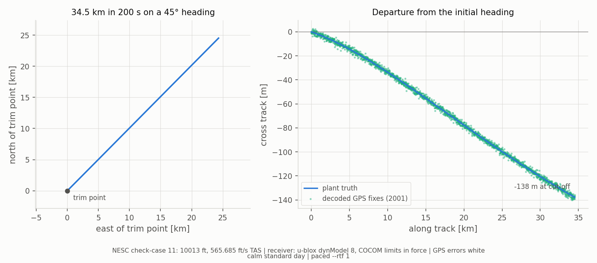

   The flyout, and the departure the flyout cannot show. At true aspect ratio
   (left) an open-loop trim flyout is a straight line: 34.5 km on a 45°
   heading, and drawing the 2001 decoded fixes on top of it would be a lie of
   resolution, since 1.5 m of injected horizontal noise sits inside the width
   of the line itself.

   The right panel is the same flight with the commanded heading rotated out:
   cross-track departure in metres against kilometres flown. The aircraft is
   asked to hold 45° and does not quite, reaching **−138 m by cut-off**
   (−369 m on the pre-0.17.4 plant, whose phugoid turned it further) — and
   *this* is the quantity the published
   participants disagree about. It is also the scale at which the receiver's
   error is finally visible as what it is: a metre-scale scatter about a
   track that departs by more than a hundred. Drawn from
   ``--case 11 --seed 11 --gps-period 0.1 --step 0.01 --rtf 1`` against
   Aetherion 0.18.2 @ 49e75b8, on Windows 11 / MSVC, 2026-11-13.

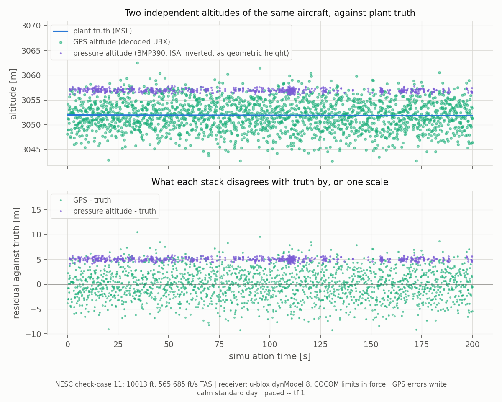

   The figure check-case 11 exists for. Barometric altitude and GNSS altitude
   are physically unrelated measurements — a pressure and a set of ranging
   solutions — and a filter that is going to trust their agreement should be
   shown that agreement first, on a flight where both are valid for all 200 s.
   On Aetherion 0.18.2 the aircraft holds its trim altitude (3051.8–3052.0 m
   over the window), so what the panels show is the sensors, not the flight.

   The lower panel is the content, and the two error *characters* are the
   point rather than the two magnitudes:

   * **GPS is noise.** Mean −0.04 m, RMS 3.05 m over 2001 fixes — which is
     ``GpsNoiseConfig``'s 3 m vertical 1-sigma recovered end to end, through
     the UBX encoder, the socket and the parser, with nothing added.
   * **The barometer is bias.** Mean **+5.04 m**, RMS 5.05 m, scatter 0.34 m:
     the residual is almost all offset. In pressure it is a constant −44.6 Pa
     with 3.0 Pa of scatter — the BMP390 model's per-run turn-on offset
     (30 Pa 1-sigma, drawn once; seed 11 draws −44.7 Pa, which the truth log
     records) sitting on its datasheet noise floor, read through the ISA at
     0.904 kg/m³. No amount of averaging removes it; only a reference pressure
     does. Pressure altitude is converted from the ISA's geopotential altitude
     to geometric height before it is compared with truth; read raw it would
     carry a further −1.47 m that belongs to the altitude convention, not to
     the sensor.

   Drawn from ``f16_trim_cosim --case 11 --seed 11 --gps-period 0.1
   --step 0.01 --rtf 1`` against Aetherion 0.18.2 @ 49e75b8, on Windows 11
   (MSVC). The paced loop fell behind there — 200 s of flight took about
   595 s of wall clock — and the polled barometer delivered 628 conversions;
   the gaps in its band are that, not the part. The GPS fixes are unaffected.

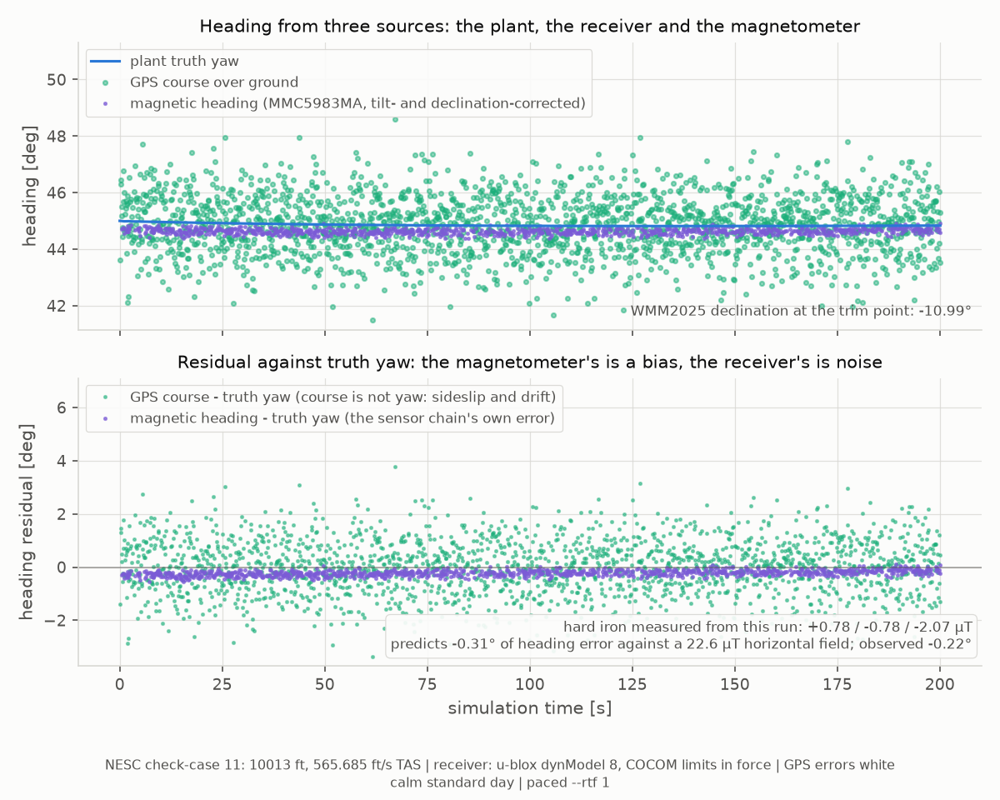

   The second half of the cross-sensor claim, and the harder half. Recovering
   a heading from a magnetometer needs the aircraft's own tilt and the local
   declination; both are taken from the simulation here — truth roll and
   pitch, and the declination the host recorded when it evaluated the field —
   because the question is whether the *sensor chain* preserves heading, not
   whether an attitude filter can be built.

   That declination is **−10.99°**, WMM2025 at the trim point. Until
   2026-09-28 it was **+0.69°**, because the host drove a centred dipole, which
   has almost no declination structure. The figure is the same shape either
   way; what changed is that it is now a statement about Kitty Hawk.

   **The magnetometer is off by a bias, and it is supposed to be.** The MMC5983MA
   model draws a hard-iron offset once per run, 1 µT 1-sigma per axis, on top
   of the bridge offset. The bridge offset is what a SET/RESET pair cancels,
   and the driver's bring-up calibration duly removes it — the residual here is
   what SET/RESET *cannot* touch, because hard iron is a real field the
   installation adds rather than an electrical null error.

   The figure measures that offset from the run rather than asserting it. The
   mean of (decoded − truth field) is **+0.79 / −0.79 / −2.08 µT**, which
   against this site's 22.6 µT horizontal field predicts **−0.32°** of heading
   error; the observed residual is **−0.23°**. Those two numbers agreeing is
   the check that the tilt compensation above is right.

   The error is small *for this draw*, and that is worth reading carefully
   rather than as good news: the heading cost of a hard iron depends on its
   direction relative to the horizontal field, not on its size. This one lies
   nearly along the field. A draw across it, from the same 1 µT-per-axis
   distribution, costs degrees — this page shipped one that cost 5.2°. The
   prediction above is first order in the offset's *components* for exactly
   that reason; using its magnitude instead gives an upper bound that is close
   when the offset happens to lie across the field and badly wrong when it does
   not.

   The consequence for ``modules/gnc`` is the whole point: raw magnetic
   heading is not a heading reference. The bias is constant, observable, and
   exactly the kind of state an EKF is supposed to estimate — which is what
   makes case 11 the flight to judge it on. GPS course, meanwhile, is not yaw
   at all (it is where the velocity vector points, not the nose), and its
   residual is the noise plus the sideslip, not an error.

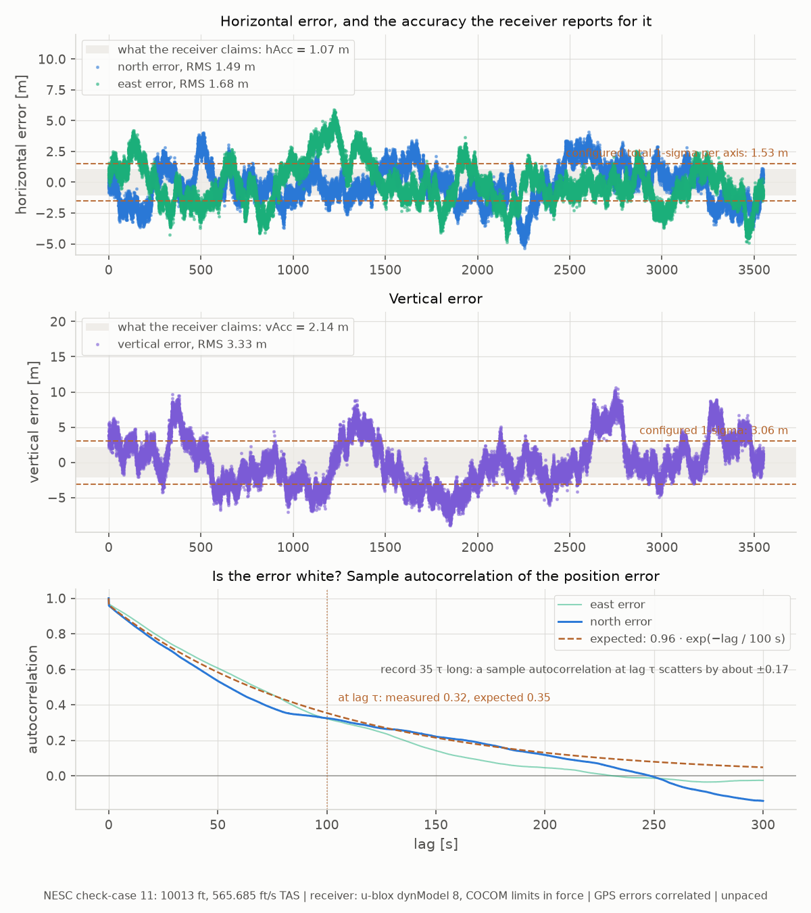

   The receiver as the EKF will meet it: ``--gps-errors correlated``, the
   realistic preset, on the one figure of this page not drawn from the run
   above — the receiver model's realistic configuration is opt-in, and it
   needs a long record.

   The upper panels are the same measurement as the altitude figure's GPS
   residual, on a flight long enough to show its character. The RMS is where
   the default's was — 1.49 / 1.69 m per axis and 3.33 m vertical against a
   configured 1.53 / 3.06 — but the error no longer scatters about zero from
   one fix to the next; it *wanders*, in excursions a hundred seconds wide,
   because 96 % of its variance is a first-order Gauss–Markov term with a
   100 s correlation time and only the remainder is white. Averaging ten
   fixes buys a filter nothing here. And the shaded band is what the
   receiver *claims*: ``hAcc`` reads 1.07 m for an error whose RMS is 1.5 m —
   the 70 % optimism real receivers show — so a filter that weights fixes by
   the reported accuracy under-weights the truth by exactly that ratio.

   The lower panel asks the question the RMS cannot: the sample
   autocorrelation of the north error, against the curve the run's own
   sidecar predicts. At lag τ = 100 s it measures **0.32 north and 0.32 east
   against an expected 0.35**; at 10 s, 0.86 and 0.89 against 0.87. The same
   panel drawn from the default run is a spike at zero lag and nothing
   after. The record is 35 τ long — the flight computer's wall-clock cap
   (``--max-wall-s``) ended its log at 3548 s of a 10 000 s run — so a
   sample autocorrelation at lag τ scatters by about ±0.17, which the figure
   prints beside the curve; the measured 0.32 is three and a half of those
   from zero. That is the point: this error is not white, and a filter tuned
   as though it were would be confidently wrong by the correlated share.

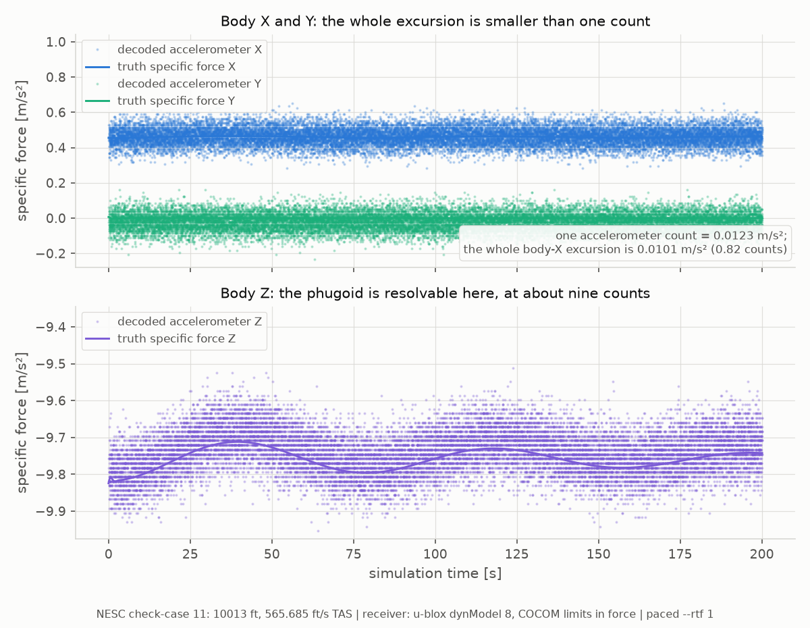

   Specific force, split by scale because one axis cannot carry both: body Z
   sits near −9.8 m/s² holding the aircraft up while X and Y live within
   hundredths of zero, and drawn together the lateral and forward channels
   collapse onto a line.

   The upper panel is the honest result. One accelerometer count is
   **0.0123 m/s²**, and the entire body-X excursion over 200 s of flight is
   **0.0101 m/s² — 0.82 of one count**. The forward channel of this IMU cannot
   see the phugoid at all; what varies in that band is the noise model, not the
   aircraft. The lower panel is the counter-case: body Z moves about nine
   counts, and the phugoid is plainly there, riding visibly through the
   discrete levels.

.. _f16_trim_body_rates:

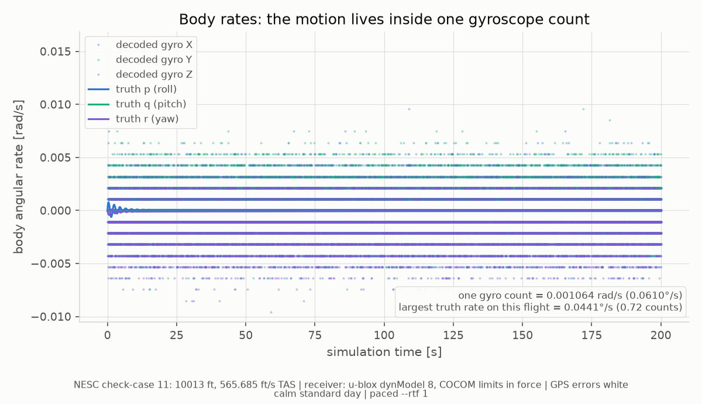

   This figure looks broken and is not. The decoded samples lie on discrete
   bands because the gyroscope is a 16-bit part at ±2000 °/s — one count is
   **0.0610 °/s** — and on an open-loop trim flyout *every body rate the
   aircraft actually has is smaller than one count*. The largest truth rate
   over the whole flight is 0.0426 °/s, **0.70 of a count**; the truth traces
   run through the middle of the zero band, and the banding above and below is
   the noise model being quantised, not motion.

   It earns a figure of its own for what it rules out. A filter cannot
   integrate these rates into an attitude on this flight — the signal is below
   the sensor's resolution, so dead reckoning has nothing to work with, and
   heading has to come from the magnetometer and the receiver instead. That is
   the argument for the two consistency figures above, made by the sensor that
   fails to make it.

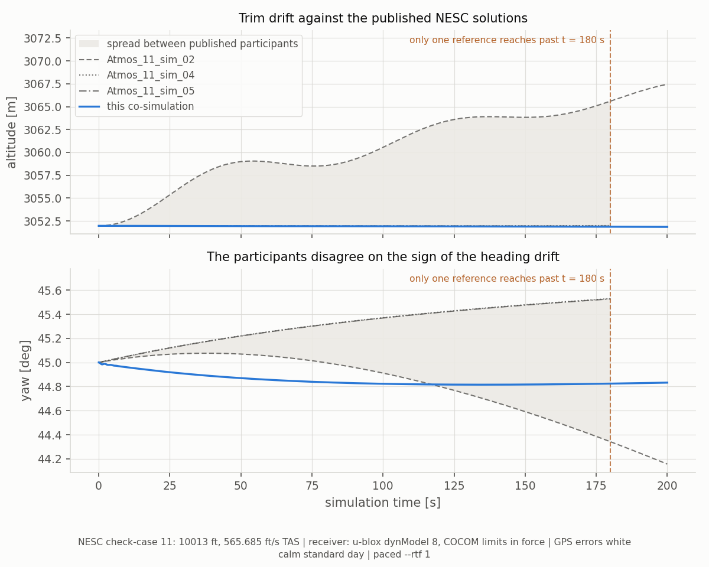s, and a marker at t=180 s past which only one reference continues

   This run against the published participant solutions — a sanity bound, not
   a precision test, and the figure is drawn to make that unmistakable. The
   shaded band is the spread *between the published solutions*: where it is
   narrow the participants agree and a deviation means something, and where it
   is wide they do not and it does not.

   On altitude the band is wide by t = 100 s only because ``sim_02`` climbs
   (+13.6 m by t = 180 s); this run holds altitude with ``sim_04`` and
   ``sim_05``, −0.10 m at t = 180 s against their +0.03 / −0.02 m. On heading
   the participants disagree about the *direction* of the drift, and this run
   turns −0.18° by t = 180 s — ``sim_02``'s way, but inside the spread from
   t = 117 s on; before that it sits up to 0.20° below the band (t ≈ 54 s),
   while ``sim_02`` is still turning positive. Drawn from
   ``--case 11 --seed 11 --gps-period 0.1 --step 0.01 --rtf 1`` against
   Aetherion 0.18.2 @ 49e75b8, on Windows 11 / MSVC, 2026-11-13: the figure is
   plant truth only, so the host's pacing does not enter it. On the
   pre-0.17.4 plant this run sat above the altitude band, drifting +31.4 m
   through its phugoid, and turned −1.16°, past ``sim_02``.

   The band stops before the plot does, and is marked where it stops. Only
   ``sim_02`` reaches t = 200 s; a verifier that compares nothing but the times
   every reference covers leaves the last 20 s silently unchecked and still
   prints OK.

The environment, and what it changes
------------------------------------

Everything above is flown in dead calm air on a standard day. That is the
check-case as published, and it is what every figure on this page is measured
on — but it is not an atmosphere any aircraft has ever flown through, and
three of this page's own findings are artefacts of it.

Aetherion 0.16.0 gave the plant an environment: steady wind, Dryden turbulence
and an ISA offset, all opt-in and all defaulting to the calm standard day.
This example writes them from three flags, and the barometer takes the plant's
own static pressure (``out.P_Pa``) rather than inverting the standard
atmosphere from altitude, so a non-standard day reaches the sensor rather than
stopping at the airframe:

.. code-block:: console

   $ ./f16_trim_cosim --seed 11 --turbulence 8 --turbulence-seed 1
   $ ./f16_trim_cosim --seed 11 --atmosphere 20,0 --wind 0,10,0

``--seed`` is what makes the three runs below comparable. Every sensor's error
stream is then a function of that one number, so the calm and turbulent runs
carry the *same* barometer turn-on bias (+3.58 m on both) and the difference
between their figures is the air, not the draw. Before the sensor FMUs took a
seed, two runs of the same scenario differed by metres of indicated altitude
for no reason at all.

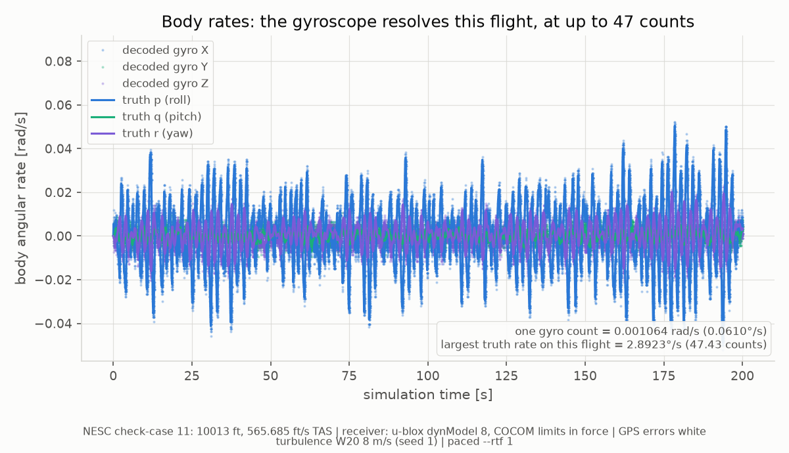

   The same figure as :ref:`the calm one above <f16_trim_body_rates>`, in
   light-to-moderate turbulence (MIL-F-8785C ``W20`` = 8 m/s). The calm flyout
   puts every body rate inside **0.7 gyroscope counts**; this one peaks at
   **47.4**, and the decoded stream becomes a measurement of the aircraft
   instead of a picture of its own quantiser.

   That is the finding this page reported — "a filter cannot integrate these
   rates into an attitude, the signal is below the sensor's resolution" —
   turned over by a factor of sixty-seven, and it was always a statement about
   the *air* rather than about the part. A real aircraft in real air sees rate
   content like this continuously; a filter tuned against the calm case would
   be tuned against a vehicle that does not exist.

   The part is unchanged and so is the seed: only ``--turbulence 8`` differs.
   The remaining lever is the range the part is programmed to, which is the
   next section.

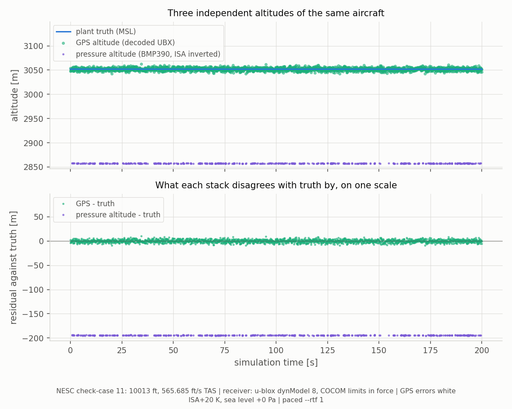

   A hot day: ISA + 20 K, nothing else changed. The barometer reads **193 m
   low** for the whole flight (−193.2 m mean, 0.3 m standard deviation, over
   538 conversions) while GNSS sits on truth (−0.04 m mean over 2001 fixes).
   Pressure altitude is converted from the standard atmosphere's geopotential
   altitude to geometric height before it is compared with geometric truth,
   as Aetherion's barometer measurement model does; without that conversion
   1.3 m of altitude convention reads as barometer error (−194.5 m). Drawn
   from ``--seed 11 --atmosphere 20,0 --gps-period 0.1 --step 0.01 --rtf 1``
   against Aetherion 0.18.2 @ 49e75b8, on Windows 11 / MSVC, 2026-11-13. The
   gaps in the barometer trace are that host's paced loop starving the
   polled part (538 decoded of 9998 latched conversions); they thin the trace
   and do not move the offset.

   Nothing is broken. Pressure altitude is not geometric altitude, and on a
   warm day the two differ by hundreds of feet — which is precisely why a
   barometer is *fused* with GNSS rather than trusted, and why the altitude
   figure further up, where they all agreed to a metre, was quietly answering
   an easier question than the one a filter faces. The plant re-trims at
   α = 2.834° against 2.639° in the same condition on a standard day, because
   the air really is thinner.

   This is also the change that needed the barometer wired to ``out.P_Pa``:
   with the part inverting the ISA from altitude it would have read the
   standard day's pressure while the aircraft flew through a warmer one,
   and this figure would show nothing at all.

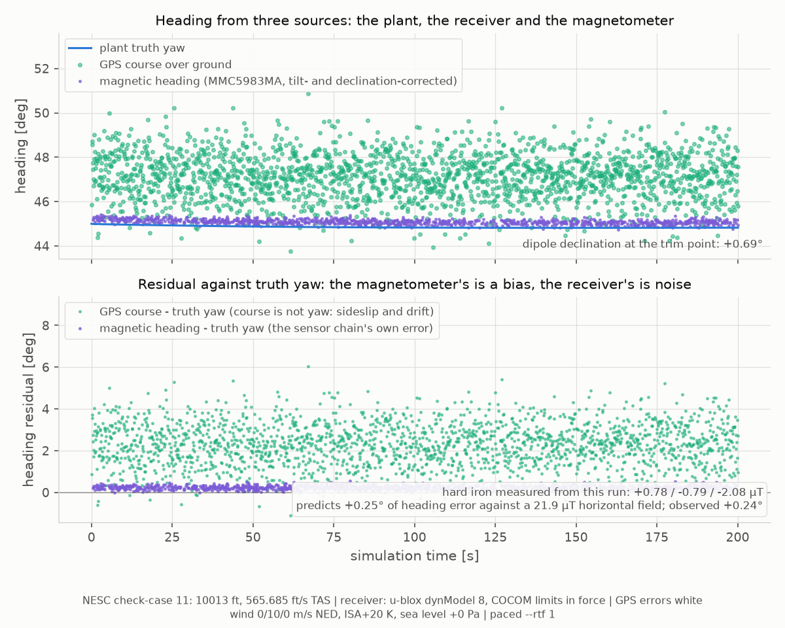

   A 10 m/s crosswind. GNSS course now sits **+2.28°** from truth yaw, where
   in calm air it sat on it to 0.02°: the aircraft is crabbing, and course
   over ground is no longer where the nose points. The geometry checks —
   10 m/s of air across a 45° heading is 7.07 m/s of crosswind on 172 m/s of
   airspeed, or 2.36°.

   That gap is a state a filter can estimate, and in calm air it does not
   exist to be estimated. The magnetometer, meanwhile, still reports yaw:
   this figure's two residual traces are now measuring *different physical
   things*, which the calm version could not show because they coincided.

   The magnetometer's own residual is small here (−0.21°) for a reason worth
   naming: with ``--seed 11`` the hard iron drawn for this run is
   +0.78 / −0.79 / −2.07 µT, which lies nearly along the local field, and an
   offset parallel to the field costs almost no heading. The annotation's
   prediction is first order in the offset's *components* rather than its
   magnitude, which is what makes it land on −0.21° here and on 5.2° for the
   larger, cross-field draw this page shipped earlier.

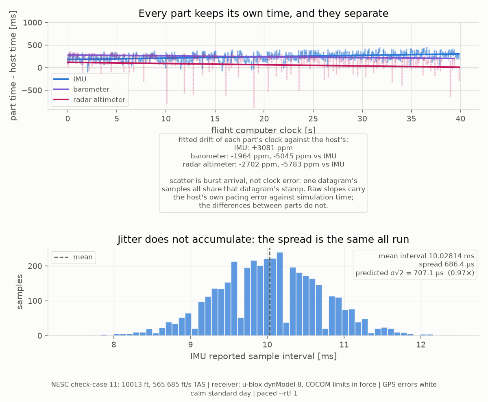

   Each part on its own oscillator, run with
   ``--sensor-clock 2000,0.0005 --rtf 1``. **2000 ppm is deliberately large** —
   perhaps two orders of magnitude above a real part — so that 40 seconds is
   enough to see; the mechanism is what the figure is about, not the
   magnitude.

   This figure and its numbers are from a 2026-09 run, unseeded, on the
   plant before Aetherion 0.17.4, and its third line is the radar altimeter,
   since removed. A re-run on Windows was held back: there the paced loop
   ran host time 1.7× simulation time with about 0.8 s rms residual, which
   swamps the per-part skew this figure exists to show. It is to be re-drawn
   from a Linux run.

   The fitted lines have different slopes because each part drew its own
   rate error from the one sigma the run configured: the barometer runs
   **5045 ppm** slower than the IMU. That is the point of the item. A filter fusing these streams cannot
   treat a sample the IMU stamps 10.00 s as contemporaneous with one the
   barometer stamps 10.00 s, and before this existed it could, because every
   part shared the master's clock exactly.

   Two honesty notes the panel carries. The *scatter* is not clock error:
   samples arrive in bursts and every sample in a burst carries that burst's
   arrival stamp, so the raw difference sawtooths by the burst's duration —
   which is itself a thing a real flight computer sees, and is why the drift is
   fitted rather than eyeballed. And each raw slope also contains the host's
   own pacing error against simulation time, which is common to every part
   and cancels in their differences; measured against its nominal cadence
   instead, the IMU's own skew on this run is **+2814 ppm**.

   The lower panel is jitter, and shows how it differs in kind: the spread of
   reported sample intervals is **686.4 µs** against the
   :math:`\sigma\sqrt{2} = 707.1` µs that differencing two independent 500 µs
   draws predicts, and it is the same at the end of the run as at the start
   because jitter has no memory. Skew accumulates; jitter does not.

Check-case 12: stacks outside their envelopes
~~~~~~~~~~~~~~~~~~~~~~~~~~~~~~~~~~~~~~~~~~~~~

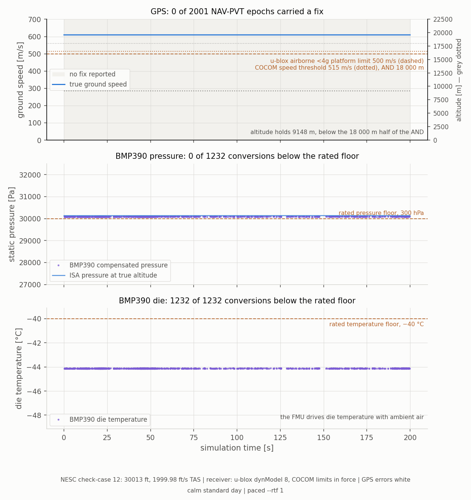

   The whole difference between the two check-cases, in one figure. Each panel
   puts a stack against the limit that bounds it; on case 11 every trace sits
   clear of its line for 200 s, and here the receiver and the barometer are
   each on the wrong side of one of theirs from the first epoch — **while
   every part keeps talking**. That distinction is what the example is built
   to make: an envelope violation is not a silent bus, and none of these
   figures is an empty file. Drawn from ``f16_trim_cosim --case 12 --seed 11
   --gps-period 0.1 --step 0.01 --rtf 1`` against Aetherion 0.18.2 @ 49e75b8,
   on Windows 11 (MSVC), where the paced loop fell behind (about 470 s of wall
   clock for 200 s of flight); that thins the barometer's points and changes
   none of the counts' proportions.

   * **GPS: 0 of 2001 epochs carried a fix.** 610 m/s is past the airborne
     <4 g platform model's 500 m/s bound from the very first epoch. The
     receiver keeps emitting one NAV-PVT per epoch throughout, ``gnssFixOK``
     clear, no position in the payload.
   * **COCOM is an AND, and this is the flight that proves it.** The speed
     threshold (515 m/s, dotted) is exceeded and the altitude threshold is
     not — the grey dotted trace holds 9148 m against an 18 000 m bound. An
     OR receiver would have lost the fix to COCOM here; this one does not, and
     what takes the fix is the platform model instead. The rocket scenario
     crosses both thresholds within seconds of each other and cannot tell the
     two apart.
   * **BMP390: the die is at −44.1 °C for all 1232 decoded conversions**,
     below its −40 °C rating. Pressure is the closer call: holding 9148 m, the
     aircraft never takes the part below its 300 hPa floor — 0 of 1232
     conversions, minimum 300.8 hPa — so on this plant the barometer is out of
     rating on temperature alone. (On the pre-0.17.4 plant a +218 m phugoid
     carried it to 291.2 hPa, below the floor for 709 of 768 conversions.)
     The part model saturates only at the ADC rails, so the out-of-rating
     conversions read plausibly — as they would on real silicon, which offers
     no out-of-rating indication either. The FMU supplies the side channel the
     part cannot: ``conversions_out_of_rating`` counts the violation on an FMI
     output.

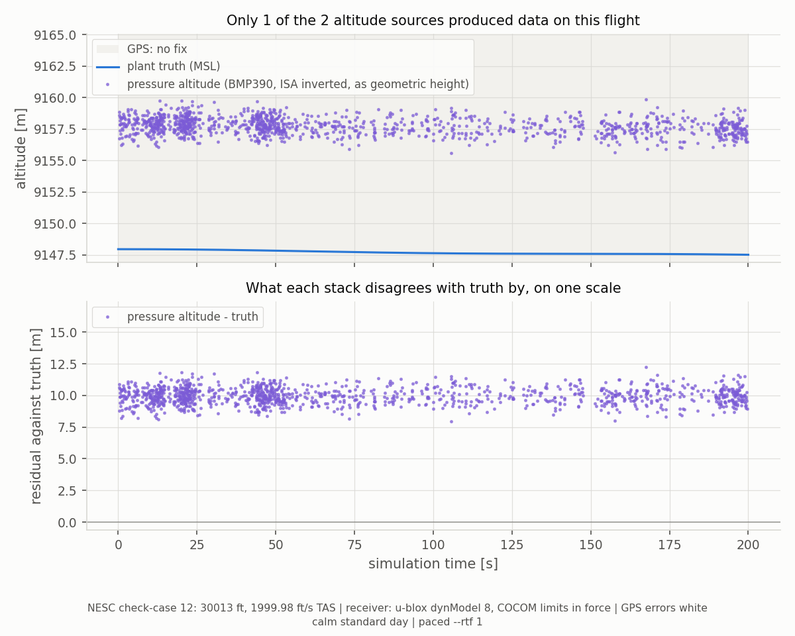

   The same figure as the case-11 altitude comparison, on the flight where
   there is nothing to compare. The no-fix wash runs the full width, and
   **one of the two altitude sources survives** — the barometer, every one of
   its 1232 decoded conversions made with its die below the temperature the
   part is rated for.

   Its residual is worth reading rather than dismissing. The bias is
   **+9.97 m** here against +5.04 m on case 11, and it is still a bias: RMS
   9.99 m against a mean of +9.97, scatter 0.66 m, so the residual is almost
   entirely offset. In pressure it is −44.7 Pa with the same 3.0 Pa of
   scatter — *the same* turn-on offset as case 11, since both runs are
   ``--seed 11`` and the seed fixes the draw. What the flight changes is the
   exchange rate: at 9.15 km the air is 0.458 kg/m³, half of case 11's
   0.904, so **the same pressure error buys twice the altitude** — 1.98×,
   measured. The sensor has not become noisy outside its rating; a
   barometer's fixed pressure error is simply worth more metres the higher it
   flies. A fusion filter given this stack alone on this flight would hold
   altitude confidently, and hold it ten metres high. (Read raw, without the
   geopotential-to-geometric conversion, the residual would carry a further
   −13.1 m of altitude convention at this height and appear as −3.2 m.)

   Drawn from the same run as the envelope figure above: ``--case 12
   --seed 11 --gps-period 0.1 --step 0.01 --rtf 1``, Aetherion 0.18.2 @
   49e75b8, Windows 11 (MSVC); the clusters and gaps in the barometer's
   points are that host's polling, not the part.
